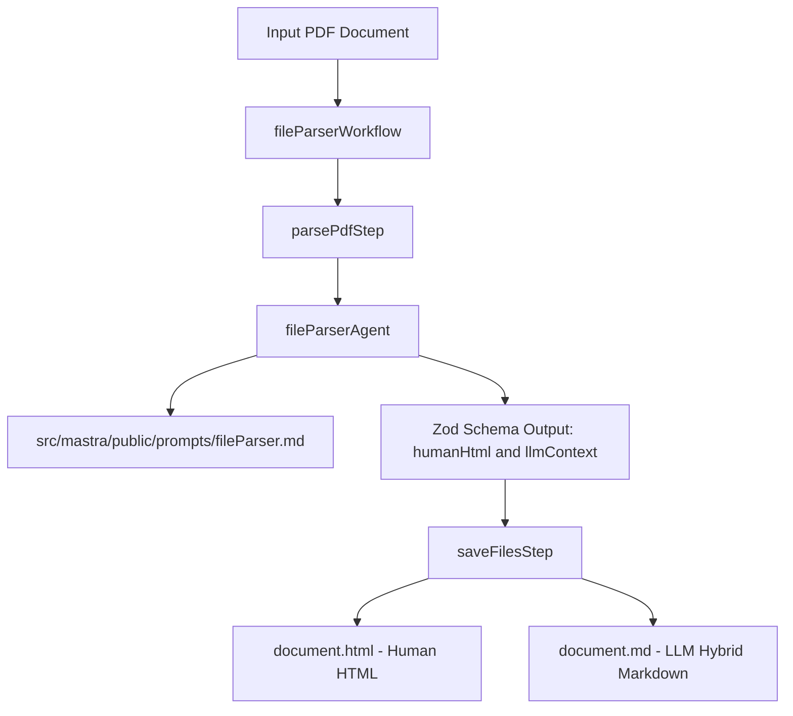

# Plan: Dual Parsing for File Parser Agent & Workflow

This document outlines the plan for updating [`src/mastra/agents/fileParserAgent.ts`](src/mastra/agents/fileParserAgent.ts:1) and [`src/mastra/workflows/fileParserWorkflow.ts`](src/mastra/workflows/fileParserWorkflow.ts:1) to support generating two distinct document representations: **Human-friendly HTML** and **LLM-optimized Hybrid Markdown**.

---

## Architecture Diagram

---

## Key Decisions & Requirements

1. **Prompt Consolidation (`src/mastra/public/prompts/fileParser.md`)**:
   - Merge instructions from [`src/mastra/agents/draft1fileParser.md`](src/mastra/agents/draft1fileParser.md:1) and [`src/mastra/agents/draft2fileParser.md`](src/mastra/agents/draft2fileParser.md:1).
   - Instruct the agent to produce two fields:
     - `humanHtml`: Semantic HTML5 suitable for visual reading/printing with embedded styling and preserved layout/tables.
     - `llmContext`: Token-efficient hybrid Markdown with HTML `<table>` elements for complex table structures with `colspan` and `rowspan`.
   - Include strict guardrails (zero hallucination, `[неразборчиво]`, square-bracketed notes for stamps/signatures).

2. **Agent Configuration (`src/mastra/agents/fileParserAgent.ts`)**:
   - Maintain existing `createQuotaAgent` wrapper and instructions loader reading `./prompts/fileParser.md`.

3. **Workflow Redesign (`src/mastra/workflows/fileParserWorkflow.ts`)**:
   - **`parsePdfStep`**:
     - Call `fileParserAgent.generate` requesting structured output schema `z.object({ humanHtml: z.string(), llmContext: z.string() })`.
   - **`saveFilesStep`**:
     - Save `humanHtml` to `<filename>.html` alongside the source file.
     - Save `llmContext` to `<filename>.md` alongside the source file.
     - Return paths to both saved files and parsed contents.

---

## Actionable Todo List

- [ ] Combine `draft1fileParser.md` and `draft2fileParser.md` into a single system prompt at `src/mastra/public/prompts/fileParser.md` tailored for Zod structured output (`humanHtml` and `llmContext`).
- [ ] Update [`src/mastra/agents/fileParserAgent.ts`](src/mastra/agents/fileParserAgent.ts:1) description and ensure proper configuration.
- [ ] Update [`src/mastra/workflows/fileParserWorkflow.ts`](src/mastra/workflows/fileParserWorkflow.ts:1) schemas and step implementations to process structured response and write both `.html` and `.md` files.
- [ ] Verify workflow execution with test PDF file.
