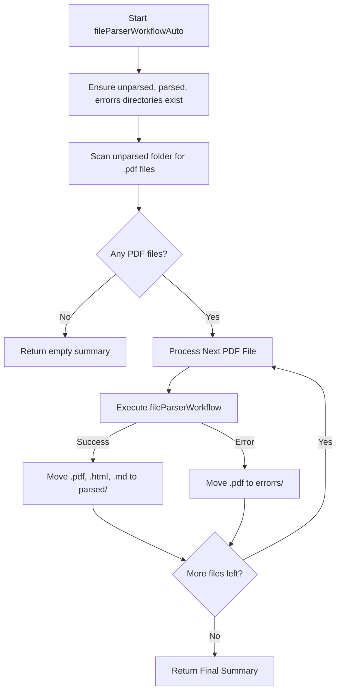

# Implementation Plan: Batch File Parser Workflow (`fileParserWorkflowAuto.ts`)

Create a new automated batch file parser workflow in `src/mastra/workflows/fileParserWorkflowAuto.ts` that processes all PDF documents in a specified directory structure.

## Directory Structure

Target root path: `D:\pr_gt\norm_docs\parsing`

- `unparsed/`: Directory containing incoming PDF files to process.
- `parsed/`: Directory for successfully processed `.pdf`, `.html`, and `.md` files.
- `errorrs/`: Directory for `.pdf` files that encountered errors during parsing.

## Workflow Specifications

### Workflow ID & Input/Output Schemas

- **ID**: `file-parser-workflow-auto`
- **Input Schema**:
  - `folderPath`: `z.string().default('D:\\pr_gt\\norm_docs\\parsing')`
- **Output Schema**:
  - `totalFiles`: `z.number()`
  - `successfulFiles`: `z.number()`
  - `failedFiles`: `z.number()`
  - `results`: `z.array(z.object({ fileName: z.string(), status: z.enum(['success', 'error']), error: z.string().optional() }))`

### Steps & Logic Flow

1. **`processFolderStep`**:
   - Resolve `unparsed`, `parsed`, and `errorrs` subfolder paths relative to `folderPath`.
   - Ensure all three directories exist on disk using `fs.mkdir(..., { recursive: true })`.
   - Read directory contents of `unparsed/` and filter for `.pdf` files (case-insensitive).
   - Sequentially iterate over each file:
     - Execute `fileParserWorkflow.execute({ inputData: { filePath: originalPath } })`.
     - **On Success**:
       - Move original PDF (`originalPath`), generated HTML (`.html`), and generated Markdown (`.md`) to `parsed/`.
       - Record result as `success`.
     - **On Error**:
       - Move original PDF (`originalPath`) to `errorrs/`.
       - Record result as `error` with the error message.
   - Return batch execution summary.

2. **Mastra Registration**:
   - Register `fileParserWorkflowAuto` in `src/mastra/index.ts` under the `workflows` config object.

## Architecture Diagram

## Action Items Checklist

- [ ] Create `src/mastra/workflows/fileParserWorkflowAuto.ts`
- [ ] Define `inputSchema` and `outputSchema`
- [ ] Implement `processFolderStep` with directory check, sequential PDF loop, file relocation (`fs.rename`), and error trapping
- [ ] Import and register `fileParserWorkflowAuto` in `src/mastra/index.ts`
