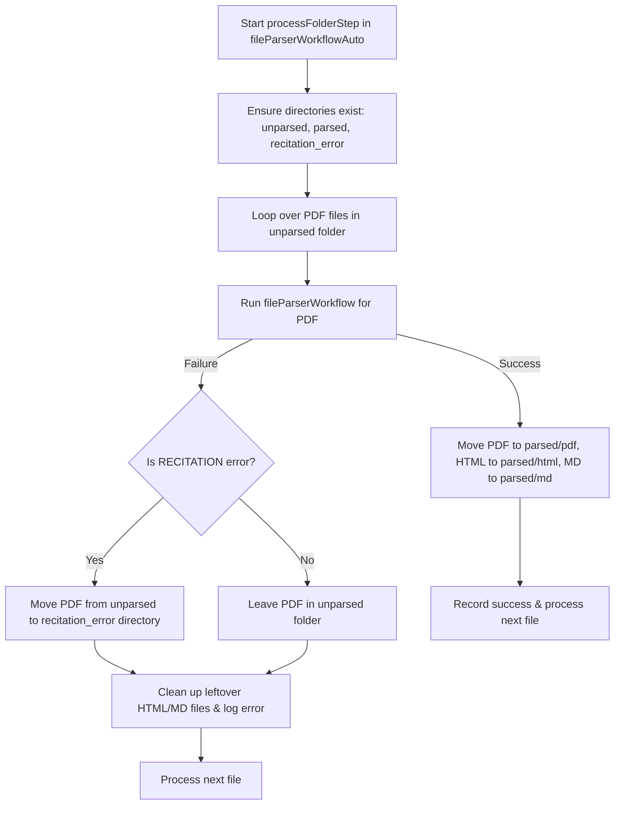

# Plan: Handle RECITATION Error and Folder Routing

## Problem Overview

When parsing PDF documents using Google Gemini, responses may occasionally be blocked due to the `RECITATION` finish reason (copyright material match).

Key requirements:

1. Detect `RECITATION` finish reason / errors correctly (not confusing it with standard successful responses that contain `citationMetadata`).
2. Move files with `RECITATION` errors to `recitation_error` folder.
3. For **all other errors** (e.g., network issues, temporary failures, schema parse errors), **keep the PDF file in the `unparsed` folder** so it can be re-tried or handled later (do not move it to `errors`).

---

## Technical Architecture

### 1. Detection Logic

Distinguish between:

- **RECITATION Error**: `finishReason === 'RECITATION'` OR response text/error message containing `"finishReason": "RECITATION"` / `"may contain material that resembles existing copyrighted works"`.
- **Standard Successful Response with Citations**: `finishReason === 'STOP'` with `citationMetadata` (this is valid output and should not trigger RECITATION error).

### 2. Workflow Changes

#### `src/mastra/workflows/fileParserWorkflow.ts`

- Wrap `fileParserAgent.generate()` in error detection logic.
- Inspect provider response / raw error for `finishReason === 'RECITATION'` or recitation error message.
- Throw a explicit error prefixed with `RECITATION: ...` when a recitation error is caught.

#### `src/mastra/workflows/fileParserWorkflowAuto.ts`

- Create `recitation_error` directory at `path.join(baseFolder, 'recitation_error')`.
- In the `catch (err)` block of `processFolderStep`:
  - Check if error is a `RECITATION` error.
  - **If RECITATION**: Move source PDF from `unparsed` to `recitation_error` directory.
  - **If OTHER ERROR**: Do **NOT** move source PDF to `errors` directory; leave it in `unparsed`.
  - Clean up any temporary HTML/MD files in `unparsed` if created.

---

## Flowchart

---

## Implementation Plan

### Step 1: Detect Recitation Errors in `fileParserWorkflow.ts`

- Helper function `isRecitationError(err: any): boolean`.
- Inspect `response` or thrown errors in `parsePdfStep` execution.
- Throw explicit `Error('RECITATION: Gemini filtered content due to recitation risk...')` when detected.

### Step 2: Handle Routing in `fileParserWorkflowAuto.ts`

- Remove auto-creation of `errorsFolder` (or keep it unused).
- Create `recitationErrorFolder` (`path.join(baseFolder, 'recitation_error')`).
- If `isRecitationError(err)` is true: move `sourcePdfPath` to `path.join(recitationErrorFolder, fileName)`.
- Otherwise: log error and leave file in `unparsedFolder`.
